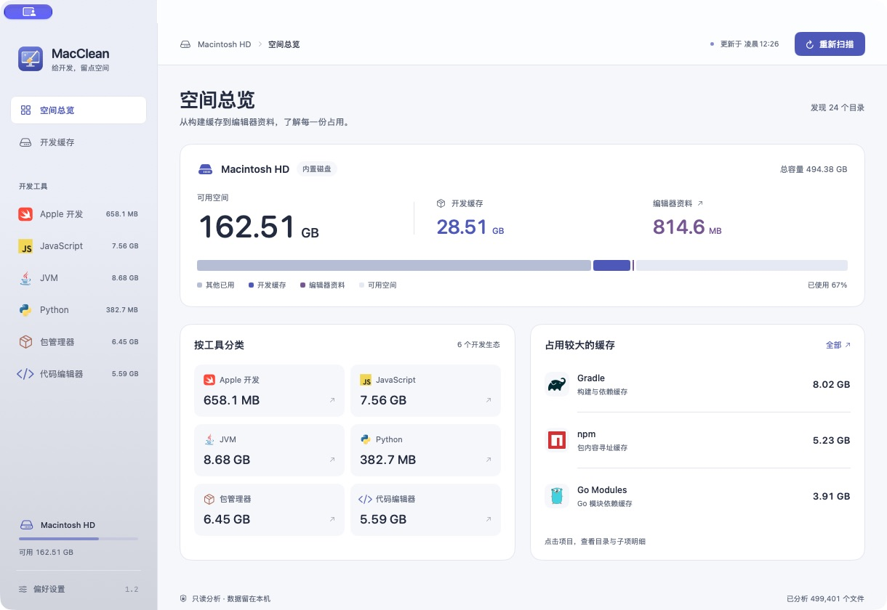
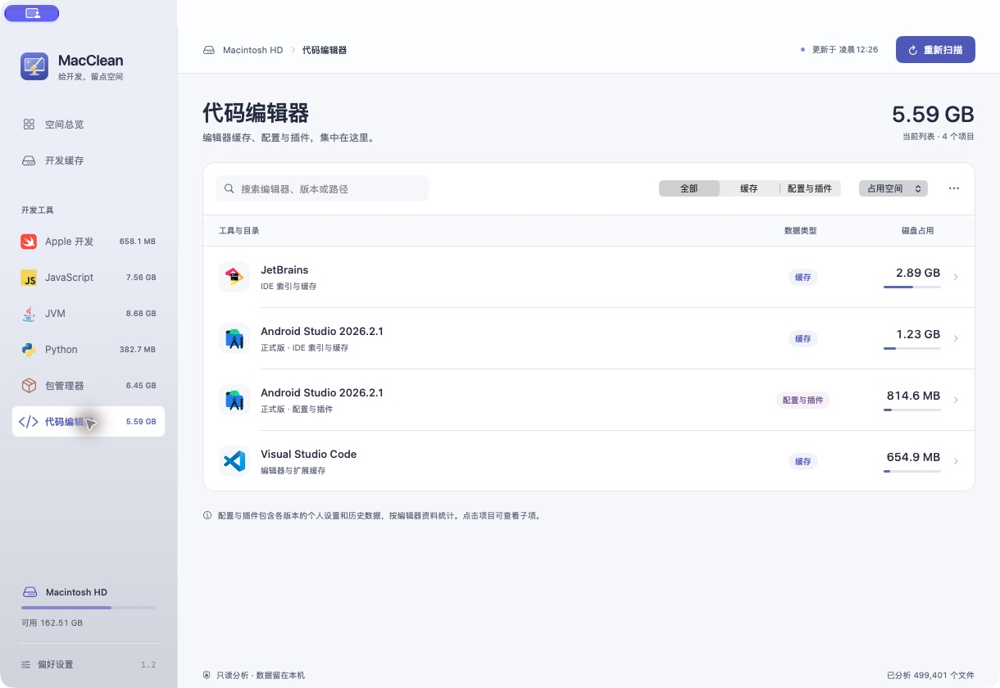
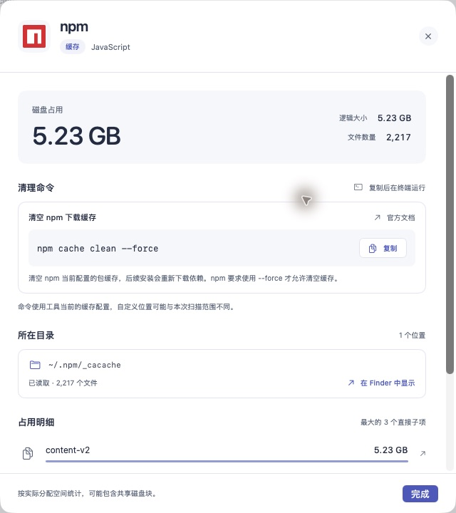
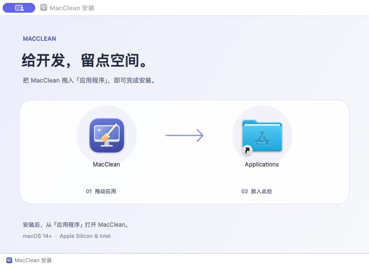

<div align="center">
  
  <h1>MacClean</h1>
  <p><strong>给开发，留点空间。</strong></p>
  <p>面向开发者的 macOS 磁盘分析工具，找出构建缓存、依赖下载与编辑器资料的占用。</p>
  <p>
    <a href="https://github.com/tianguzhe/MacClean/actions/workflows/ci.yml"></a>
    
    
  </p>
  <p>
    <a href="https://github.com/tianguzhe/MacClean/releases">下载版本</a> ·
    <a href="https://github.com/tianguzhe/MacClean/actions">构建记录</a> ·
    <a href="https://github.com/tianguzhe/MacClean/issues">反馈问题</a>
  </p>
</div>



## 能做什么

- **看清磁盘占用**：汇总磁盘空间、开发缓存和编辑器资料，按工具分类、搜索与排序。
- **发现开发工具缓存**：覆盖 6 个开发生态、43 项默认缓存，并动态识别 Android Studio 各版本目录。
- **查看目录明细**：展示物理占用、逻辑大小、文件数和最大的直接子项，支持在 Finder 中定位。
- **复制官方清理命令**：在工具详情中查看命令、适用版本和清理范围；部分工具同时提供预览命令。
- **区分缓存与个人资料**：编辑器页面统一展示缓存、配置与插件，个人资料独立统计。
- **保持轻巧**：原生 SwiftUI 界面、后台扫描、实时进度与取消，动效遵循系统“减少动态效果”设置。

**MacClean 只做本地分析，不自动删除文件、不执行清理命令，也不上传扫描数据。**

## 支持的开发工具

| 分类 | 主要工具与缓存 |
| --- | --- |
| Apple 开发 | Xcode Derived Data、Xcode 缓存、Simulator 共享缓存、Swift Package Manager、CocoaPods |
| JavaScript | npm / npx、pnpm、Yarn、Bun、NVM、Deno、node-gyp、Playwright、Cypress、Puppeteer |
| JVM | Gradle、Gradle Wrapper、Android 构建缓存、Maven、Coursier、Ivy |
| Python | pip、uv、Poetry、Conda 下载归档与索引、Hugging Face |
| 包管理器 | Homebrew、Cargo、Go 构建与模块缓存、Composer、NuGet、Dart / Flutter Pub、ccache、sccache、mise、Helm |
| 代码编辑器 | Visual Studio Code、Cursor、JetBrains、Android Studio 各版本缓存与配置插件 |

完整路径、官方文档与统计边界见[开发缓存目录调研](docs/cache-research.md)。当前匹配已知默认位置，自定义环境变量或自定义缓存路径不在扫描范围内。

Android Studio 每次扫描都会发现以下目录中的正式版、Preview 和备份目录，并统一显示在“代码编辑器”中：

```text
~/Library/Caches/Google/AndroidStudio*
~/Library/Application Support/Google/AndroidStudio*
```

其中配置、插件及可能存在的历史数据按“编辑器资料”单独统计，不计入开发缓存总量。仅匹配 Android Studio 版本目录，不扫描整个 Google 目录或 Chrome 浏览记录。

## 页面预览

<details>
<summary>代码编辑器：缓存、配置与插件集中查看</summary>



</details>

<details>
<summary>工具详情：查看占用，复制清理命令</summary>



</details>

<details>
<summary>DMG 安装：拖入「应用程序」</summary>



</details>

## 下载与安装

支持 **macOS 14+**，同一个安装包适用于 **Apple Silicon 与 Intel**。

1. 在 [Releases](https://github.com/tianguzhe/MacClean/releases) 中下载 `MacClean.dmg`。
2. 打开安装包，将 MacClean 拖入「应用程序」。
3. 从「应用程序」启动，等待扫描完成；点击工具查看目录和清理命令。

如需验证下载，将同一版本的 `MacClean.dmg.sha256` 放到安装包旁，在该目录运行：

```sh
shasum -a 256 -c MacClean.dmg.sha256
```

尚未发布版本时，可以从 [CI 构建记录](https://github.com/tianguzhe/MacClean/actions/workflows/ci.yml) 下载成功构建的安装包 Artifact，或按下文从源码构建。

当前构建使用 ad-hoc 签名，尚未配置 Developer ID 签名和 Apple 公证；如需正式签名分发，需要另行配置。

## 从源码构建

需要 **Xcode 16+ / Swift 6**；制作 DMG 另需 **Python 3.10+**。应用本身没有第三方运行时依赖，扫描核心通过本地 Swift Package 引入。

先配置 [GitHub SSH key](https://docs.github.com/en/authentication/connecting-to-github-with-ssh)，再使用 SSH 克隆仓库：

```sh
git clone git@github.com:tianguzhe/MacClean.git
cd MacClean
open MacClean.xcodeproj
```

在 Xcode 中选择 **MacClean → My Mac** 运行，也可以通过脚本测试、构建通用应用：

```sh
./Scripts/test.sh
./Scripts/build.sh
open dist/MacClean.app
```

一条命令构建并制作安装包：

```sh
./Scripts/build-dmg.sh
```

已构建当前版本时，可运行 `./Scripts/build-dmg.sh --skip-build` 复用应用。打包脚本会选择可用的 Python 3.10+，也可通过 `MACCLEAN_PYTHON` 指定解释器；固定版本的打包依赖只安装到项目内的 `.build/dmg-venv`。

| 产物 | 路径 |
| --- | --- |
| 通用应用 | `dist/MacClean.app` |
| DMG 安装包 | `dist/MacClean.dmg` |
| SHA-256 校验文件 | `dist/MacClean.dmg.sha256` |
| 构建与测试日志 | `.build/*.log` |

打包时自动检查版本号、构建号、双架构和代码签名，校验 DMG 后只读挂载，检查包内应用、资源及 Applications 快捷方式。失败时显示日志末尾，完整信息保留在日志文件中。

<details>
<summary>重新生成图标与安装背景</summary>

```sh
./Scripts/generate-assets.sh
```

资源生成另需 Node.js / npm，生成依赖位于 `.build/vector-tools`。原始 SVG 保存在 `Assets/BrandSources`，应用加载保留矢量表示的 PDF。生成后的资源已包含在仓库中，常规构建无需 Node.js。

</details>

## 自动构建与发布

| 工作流 | 触发条件 | 结果 |
| --- | --- | --- |
| [CI](.github/workflows/ci.yml) | Pull Request、推送到 `main`、手动触发 | 测试、构建双架构应用、校验 DMG，上传安装包；失败时上传日志 |
| [Release DMG](.github/workflows/release.yml) | 推送 `v*` 标签 | 检查标签与源码版本一致，测试并打包，发布 DMG、SHA-256 与自动生成的版本说明 |

两条工作流使用 `macos-26` 和 Python 3.12。发布使用 GitHub 内置的 `GITHUB_TOKEN`，无需额外配置 Token。

版本统一在 [Config/Version.xcconfig](Config/Version.xcconfig) 中维护：`MARKETING_VERSION` 对应发布版本，`CURRENT_PROJECT_VERSION` 对应构建号，Xcode 的 Debug / Release 共用。

**手动发布**：更新版本与构建号，将所有改动提交到 `main`，然后运行以下命令。标签由配置生成，例如 `1.2` 对应 `v1.2`：

```sh
./Scripts/test.sh
git tag -a "$(./Scripts/version.sh --tag)" -m "MacClean $(./Scripts/version.sh)"
git push --atomic origin main "refs/tags/$(./Scripts/version.sh --tag)"
```

推送成功后，GitHub Actions 会制作并发布安装包。只推送 `main` 会运行 CI，发布版本需要额外推送标签。

已推送的标签指向固定提交。修复打包失败后，请提高版本与构建号，再推送新标签；重跑旧标签的任务不会包含后续修复。

也可用 `./Scripts/release.sh --dry-run` 检查分支、工作区与标签；不带参数运行该脚本会自动测试、创建标签并推送。

## 扫描范围与统计说明

- 扫描当前用户主目录下的已知开发缓存位置；不遍历项目源码、项目内的 `node_modules` / `.build` / `target`、虚拟环境、Xcode Archives、模拟器设备或运行时。
- 不跟随符号链接。Conda 只统计下载归档与索引，不将完整环境或已解包的软件包当作缓存。
- **缓存占用不等于可释放空间。** 物理占用按 `lstat` 的分配块大小统计，并在每个工具内对硬链接去重；APFS 共享块、快照、跨工具共享与扫描期间的文件变化可能影响结果。
- 磁盘可用空间取文件系统报告值，不额外包含系统可清除空间。
- IDE 缓存可能含本地历史，Maven 等依赖目录也可能含无法重新下载的本地构件。版本较旧或名称含 `backup` 不代表已废弃，应结合工具说明判断。
- 对不存在、访问受限或部分读取的目录分别展示状态。需要读取受保护目录时，可在系统设置中为应用配置完全磁盘访问权限后重新扫描。

## 项目结构

```text
App/                       SwiftUI 页面、主题与扫描状态
Sources/MacCleanCore/       缓存目录、扫描引擎与清理命令说明
Tests/MacCleanCoreTests/    扫描与目录发现测试
Config/Version.xcconfig     版本与构建号
Scripts/                   测试、打包、发布与资源生成
Assets.xcassets/           应用图标与品牌矢量资源
Assets/                    品牌 SVG 来源、许可证与安装背景
.github/workflows/         CI 与标签发布
docs/                      界面截图、目录调研与检查记录
```

测试覆盖隐藏文件、符号链接、硬链接、重叠目录、独立文件、稀疏文件、权限错误、取消、IDE 版本发现与 Conda 筛选。测试脚本还会通过真实 Mach-O 文件检查双架构，以及缺少 arm64 或 x86_64 时的失败行为。验证记录见[代码检查记录](docs/code-review.md)。

## 致谢

- [Devicon](https://github.com/devicons/devicon)：语言与工具品牌图标，保留其 [MIT 许可证](Assets/BrandSources/LICENSE.devicon)；各商标归原权利人所有。
- [QuietLock](https://github.com/tianguzhe/QuietLock)：构建、DMG 布局与标签发布流程参考。
